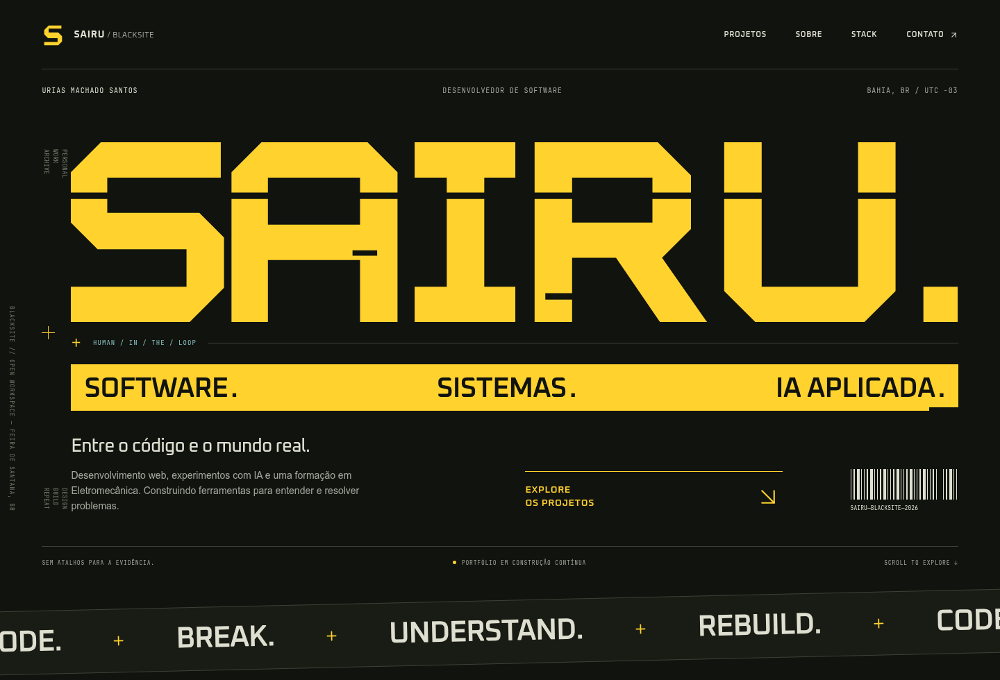
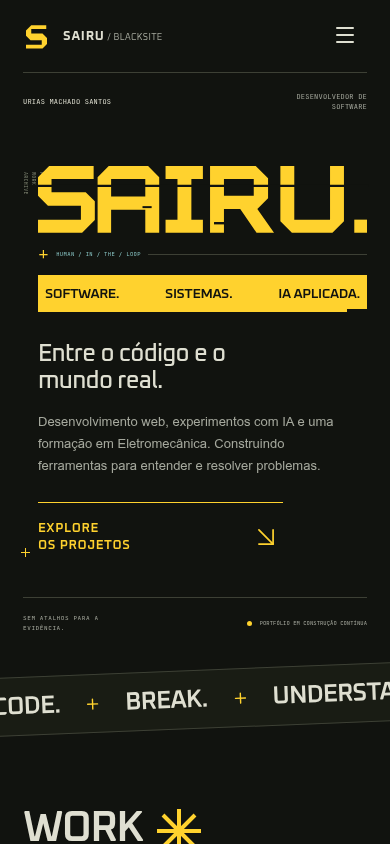

# S4IRU // BLACKSITE

Portfólio de **Urias Machado Santos (Sairu)**, desenvolvedor de software e estudante do Técnico em Eletromecânica no SENAI, em Feira de Santana (BA). Experiência profissional em aplicações web; laboratórios de IA aplicada em desenvolvimento com execução verificável.

O objetivo é apresentar trabalho técnico concreto para candidaturas, incluindo a trilha **AI Builder** do programa de estágio do iFood. Os três projetos são **demonstrações**, não produtos comerciais nem experiência profissional em treinamento de IA.

**Site público:** https://saiiru.github.io/

## Três demos executáveis

| Laboratório | Abrir em desenvolvimento | Comportamento comprovável |
| --- | --- | --- |
| EvalForge | /labs/index.html?lab=evalforge | Avalia respostas contra seis casos sintéticos com asserções explícitas e métricas recalculadas após edições. |
| OpsPilot | /labs/index.html?lab=opspilot | Classifica doze tickets fictícios, calcula cobertura/acurácia e exige aprovação humana para exportar JSON. |
| DocTrace | /labs/index.html?lab=doctrace | Recupera trechos de Markdown por relevância BM25, cita fontes e recusa responder sem evidência. |

O modo padrão é **determinístico e offline**, sem fingir que utiliza um modelo de linguagem. Existe um proxy HTTP para **LLM opcional em ambiente local** que usa variáveis LLM_BASE_URL, LLM_API_KEY e LLM_MODEL. O GitHub Pages não hospeda esse proxy, nem expõe segredos. O blueprint de n8n é um exemplo importável, **não um workflow executado em produção**.

Resultados em BENCHMARK.md foram calculados apenas sobre **dados sintéticos preparados para demonstração**. Não representam métricas comerciais, clientes, horas poupadas ou resultados de modelos reais.

## Rodar o site

Na raiz do projeto, com Node.js 24:

    npm ci
    npm run dev

Para criar a versão estática do GitHub Pages:

    npm run build
    cd docs
    python3 -m http.server 4389 --bind 127.0.0.1

Abra http://127.0.0.1:4389 no navegador.

## Testes

    cd projects/ai-builder-labs
    npm test
    node scripts/verify.mjs
    node scripts/smoke-proxy.mjs

Teste visual opcional (com Python Playwright e Chromium instalados e o servidor da pasta docs ativo):

    python3 scripts/e2e_cybergrotesk.py

O teste de navegador cobre três labs, terminal, seleção de competências, classificação e aprovação humana, exportação de relatório, busca com citações e responsividade em 390 px.

## Estrutura

- src/App.jsx, src/blacksite.css — site React, animações e lista interativa de competências.
- public/assets/img — vetores originais de rede e circuito.
- public/labs — arquivos estáticos navegáveis das demos.
- projects/ai-builder-labs — código-fonte, testes, proxy local, exemplo n8n e documentação técnica.
- docs — compilação Vite para publicação pelo GitHub Pages, sem depender de GitHub Actions.
- design/v3 — capturas reais do Chromium; design/previews preserva a direção anterior.
- DESIGN_REFERENCES.md — fontes de inspiração e restrições de propriedade intelectual.

## Créditos e referências

O ponto de partida foi o [Nothing Portfolio de Ankit Shrestha](https://github.com/ankitshrr/nothing-portfolio), licenciado sob MIT. O aviso original está preservado em [LICENSE](LICENSE).

Os projetos [Cyber Grotesk de Olga Ryzhychenko](https://www.behance.net/gallery/85843953/Cyber-Grotesk) e [Cybersecurity Portfolio da Pixiei Studio LLC](https://dribbble.com/shots/27431322-Cybersecurity-Portfolio-Website-UI-UX-Design) serviram apenas de **inspiração visual**. Não foram distribuídos seus arquivos de fontes, imagens ou artes. Os elementos gráficos são originais em CSS/SVG. Consulte [DESIGN_REFERENCES.md](DESIGN_REFERENCES.md).

## Contato

[GitHub](https://github.com/Saiiru) · [LinkedIn](https://www.linkedin.com/in/sairu/) · [E-mail](mailto:sairufsa@gmail.com).
